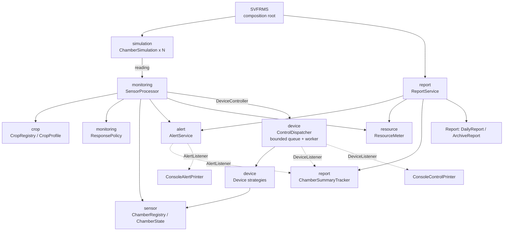
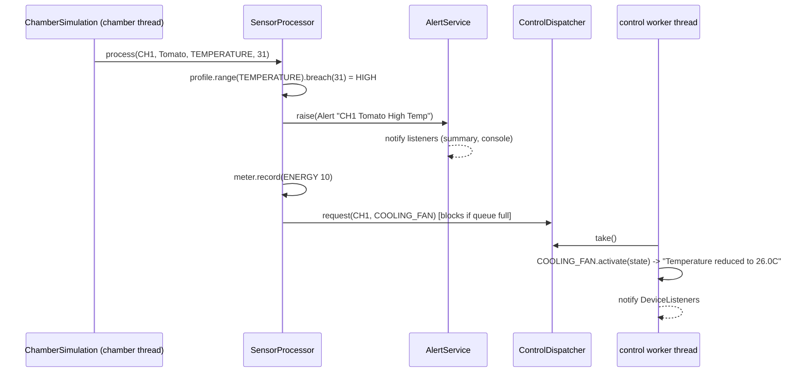

# SVFRMS Refactoring — Technical Report

## 1. Legacy System Analysis

SVFRMS monitors the growing chambers of a vertical-farming facility. Each chamber grows one crop; sensors report temperature, humidity, soil moisture, light and nutrient levels; readings outside the crop's acceptable range raise alerts and trigger corrective devices (cooling fan, water pump, humidifier, …); at the end of a run the system archives alerts, prints a daily report and saves an archive report to `archive/daily_report.txt`.

The legacy implementation is a single 393-line class, `SVFRMS`, containing:

| Concern | Legacy location |
|---|---|
| Global mutable state (alerts, logs, counters, chamber maps, locks) | `public static` fields, lines 7–31 |
| Chamber state / summary | nested classes `ChamberState`, `ChamberSummary` |
| Event handling (logging, alerts, tracking) | `handleEvent(String type, …)` string switch, lines 62–88 |
| Device control | `activateControl` if/else chain, lines 90–129 |
| Control queue (producer–consumer) | `addControlRequest` + `ControlThread`, `wait/notifyAll` on an `ArrayList` |
| Crop threshold logic | `processSensor`, 65 lines of nested `if (crop.equals(...))`, lines 141–205 |
| Reports | `generateDailyReport`, `archiveAlerts`, `saveArchiveReport` |
| Simulation | `ChamberThread extends Thread`, `main` |

## 2. Code Analysis and Limitations

### 2.1 Design issues (mapped to SOLID)

| # | Issue | Evidence | Principle |
|---|---|---|---|
| D1 | **God class.** One class does sensing, crop rules, device control, alerting, reporting, file I/O, threading and simulation. | whole file | SRP |
| D2 | **Crop rules hard-coded in `if/else` chains.** Adding Kale means editing `processSensor` in up to 3 sensor branches; thresholds, alert text, energy/water costs and devices are interleaved. | lines 145–188 | OCP |
| D3 | **Stringly-typed dispatch.** `handleEvent("TRACK_ALERT", …)`, `activateControl(…, "Cooling Fan")`; queue items are chamber and control joined into one string with a separator character and split apart again. Typos fail silently; a chamber name containing the separator breaks parsing. | lines 62–129, 136, 269 | OCP, type safety |
| D4 | **Inheritance misuse.** `ControlThread`/`ChamberThread extends Thread` only to override `run()`, inheriting dozens of unrelated `Thread` methods. The classes are tasks, not threads, and they couple the work to one way of running it. | lines 251, 275 | Composition over inheritance |
| D5 | **Fat, implicit interface.** `handleEvent` is one entry point for 6 unrelated operations; every caller depends on all of them. | line 62 | ISP |
| D6 | **Everything depends on concretions and globals.** All collaborators are `public static` fields; nothing can be substituted or tested in isolation. | lines 10–31 | DIP |
| D7 | **Dead code / leftovers.** `waterPumpLock`, `nutrientLock`, `irrigationCycle`, `feedingCycle`, `showAlerts`, `showLogs`, `ALERT_LOG` are never used; commented-out `Thread.sleep` calls. | lines 28–29, 224, 243–307, 385 | Clean code |
| D8 | **Swallowed exceptions.** `catch(Exception e){}` around `wait()` hides interrupts. | lines 134, 258 | Reliability |

### 2.2 Behavioural quirks found (preserved, see §3.4)

- Soil-moisture checks exist only for Tomato; humidity checks only for Tomato and Strawberry, although the spec lists ranges for other crops.
- Light (< 500 lux) and nutrient (< 40 %) thresholds are facility-wide, not per crop, and their alert text omits the crop name.
- Low temperature raises an alert but activates no device (no Heating Unit).
- Several features described in spec §3 were never implemented in the legacy code: alert severity levels (INFO/WARNING/CRITICAL), Sensor Failure alerts, the Heating Unit, Ventilation System and Shade Controller devices, and the Weekly Crop, Water Usage, Energy and Nutrient reports. They are out of scope for a behaviour-preserving refactor; §5 shows where each would plug in.

### 2.3 Concurrency issues

Four `ChamberThread`s and one `ControlThread` share all static state.

| # | Type | Where | Failure |
|---|---|---|---|
| C1 | Race condition | `alerts`, `sensorLogs`, `reports` are plain `ArrayList`s; `add` from 4 threads | Lost alerts, corrupted internal array, `ArrayIndexOutOfBoundsException` |
| C2 | Race condition (check-then-act) | `getChamberState`/`getChamberSummary`: `containsKey` → `put` on a `HashMap` | Two `ChamberState`s for one chamber; `HashMap` corruption under concurrent resize |
| C3 | Lost update | `totalWaterUsage += …`, `totalEnergyUsage`, `totalAlerts++`, `totalAlertsGenerated++` | Read-modify-write is not atomic → wrong totals in the report |
| C4 | Data race / visibility | `ChamberState` fields written by chamber thread (`state.temperature = value`) and read-modified-written by control thread (`activateControl`) with no lock | Device effect overwritten or computed from stale value |
| C5 | Lost update | `ChamberSummary.alerts++` (chamber threads) and `mitigationActions++` (control thread) | Chamber summary counts don't add up |
| C6 | Order race | `main` starts `archiveAlerts` and `generateDailyReport` threads simultaneously | "Active Alerts" in the report is non-deterministic (N or 0) — the commented-out `sleep(20)` shows the intern noticed |
| C7 | Liveness / deadlock | Producers `wait()` on a full queue with no timeout; if `ControlThread` dies (any `RuntimeException` in `activateControl`) nobody consumes → all 4 chamber threads block forever and `main` hangs on `join()` | System hang |
| C8 | Deadlock risk (latent) | Nested `synchronized(alertLock){ synchronized(reportLock){…} }` in two methods. Both currently take the locks in the same order, so it does not deadlock today; it stays safe only while every caller keeps that order; the locks are `public static` **non-final**, so any code can lock them in another order or reassign them | Classic lock-ordering deadlock once a third method takes `reportLock → alertLock` |
| C9 | Unsafe iteration | `showAlerts`/`showLogs` iterate shared lists while threads add | `ConcurrentModificationException` |

## 3. Proposed Design

### 3.1 Key decisions

1. **Split by responsibility into packages** (D1): `crop`, `sensor`, `device`, `alert`, `resource`, `monitoring`, `report`, `simulation`, plus `SVFRMS` as composition root.
2. **Crops become data, not code** (D2): a `CropProfile` holds a `Range` per sensor and the resource cost per breach. `SensorProcessor` contains *one* generic rule: *if the reading breaches the crop's range and the policy has a response, alert → record cost → request device.* No crop name appears in processing logic.
3. **Types instead of strings** (D3): `SensorType`, `Direction`, `Breach`, `Device`, `Alert` replace magic strings and the `"chamber|control"` encoding.
4. **Composition over inheritance** (D4): simulations are `Runnable`s run by an `ExecutorService`; the dispatcher owns its worker thread.
5. **Small role interfaces** (D5): `AlertListener`, `DeviceListener`, `DeviceController`, `Device`, `Report` each have one method.
6. **Constructor injection** (D6): every component receives its collaborators; only `SVFRMS.main` knows the concrete classes. `SensorProcessor` depends on the `DeviceController` interface, so tests pass a lambda instead of a real dispatcher.
7. **Dead code removed** (D7); interrupts restored, never swallowed (D8).

### 3.2 Concurrency fixes

| Issue | Fix |
|---|---|
| C1, C9 | Shared lists are owned by one class each and guarded: `AlertService` (synchronized), `SensorLog` and activity log (`synchronizedList`). Readers get immutable copies (`List.copyOf`), so iteration never races. |
| C2 | `ConcurrentHashMap.computeIfAbsent` in `ChamberRegistry`, `ChamberSummaryTracker`; atomic get-or-create. |
| C3 | `ResourceMeter` uses `AtomicInteger`; alert counters change inside the same lock as the alert list, so "generated" and "active" are always consistent. |
| C4 | `ChamberState` stores values in an `EnumMap` behind `synchronized` methods; devices use the atomic `adjust(sensor, delta, limit)` read-modify-write. |
| C5 | Per-chamber `Summary` methods are `synchronized`. |
| C6 | Archive and daily report run sequentially in a fixed order after all producers and the consumer have finished. |
| C7 | Hand-rolled `wait/notify` replaced by `ArrayBlockingQueue` (`put`/`take`, interrupt-aware). The worker catches per-request `RuntimeException`s so it cannot die; shutdown uses a **poison pill** that is processed only after every earlier request, so no request is lost. |
| C8 | **No nested locks anywhere.** Each component guards its own state with one lock; listeners are called *outside* the lock (no alien method calls while holding a lock); reports work on an immutable `FacilitySnapshot`. With no lock ever held while acquiring another, lock-ordering deadlock is impossible by construction. |

Evidence: `SVFRMSTest.countersSurviveConcurrentUpdates` (8 threads × 5 000 updates, exact totals) and `dispatcherDrainsEveryRequestBeforeClosing` (queue capacity 2, 100 requests, all applied).

### 3.3 Feature extension — new crops

Kale, Bell Pepper, Bok Choy and Eggplant are added as one `CropProfile.builder(...)` entry each in `CropCatalog`. Removing a crop is deleting its entry (or `CropRegistry.remove(name)` at runtime). Chambers can be assigned on the command line:

```
java -jar run.jar CH1=Tomato CH5=Kale CH6=Eggplant
```

With no arguments the original four chambers run.

### 3.4 Behaviour preservation

Thresholds, alert texts, resource costs, device effects, console formats and the archive file layout are identical to the legacy system (the set of distinct output line formats from both versions was diffed and matches). The quirks in §2.2 were deliberately kept, because the brief says not to change functionality. Each is now a one-line data change. For example, adding `.soilMoisture(50, 65)` to Strawberry enables its soil check. The only intentional behavioural change is that C6 is now deterministic.

## 4. Final Architecture



**Sequence: one out-of-range reading**



| Package | Classes | Responsibility |
|---|---|---|
| `crop` | `CropProfile` (+Builder), `Range`, `CropRegistry`, `CropCatalog` | What each crop needs |
| `sensor` | `SensorType`, `Direction`, `Breach`, `ChamberState`, `ChamberRegistry`, `SensorLog` | Readings and chamber conditions |
| `monitoring` | `SensorProcessor`, `ResponsePolicy`, `Response` | Reading → alert/cost/device rule |
| `device` | `Device`, `AdjustingDevice`, `Devices`, `DeviceController`, `ControlDispatcher`, `DeviceListener`, `ConsoleControlPrinter` | Executing corrective actions |
| `alert` | `Alert`, `AlertService`, `AlertListener`, `ConsoleAlertPrinter` | Alert lifecycle |
| `resource` | `Resource`, `Usage`, `ResourceMeter` | Water/energy accounting |
| `report` | `Report`, `DailyReport`, `ArchiveReport`, `FacilitySnapshot`, `ChamberSummaryTracker`, `ReportService` | Reporting |
| `simulation` | `ChamberSimulation` | Simulated sensor feed |

## 5. Extensibility and Maintainability

| Change | What to touch |
|---|---|
| Add/remove a crop | One entry in `CropCatalog` (or `CropRegistry.register/remove` at runtime). |
| Add a device (e.g. Heating Unit for low temperature) | One `Devices` constant + change `Response("Low Temp", true, null)` to use it in `ResponsePolicy`. |
| New alert condition (e.g. high light → Shade Controller) | One `ResponsePolicy` entry; crops that set a light max get it automatically. |
| New sensor type | One `SensorType` constant; ranges and responses as above. |
| New report (Water Usage, Energy, Nutrient…) | A new `Report` implementation rendering `FacilitySnapshot`. |
| New alert channel (email, SMS, severity routing) | A new `AlertListener` registered in `SVFRMS.main`. |
| Real sensors instead of simulation | Replace `ChamberSimulation` with a feed that calls `SensorProcessor.process`; nothing else changes. |

Each change is additive and local; existing classes stay closed for modification. Constructor injection makes every component testable in isolation (see `SVFRMSTest`).

## 6. Design Patterns

| Pattern | Where | Problem solved |
|---|---|---|
| **Builder** | `CropProfile.Builder` | Crops have many optional ranges and costs; the builder gives readable, validated, immutable profiles and applies facility defaults (light, nutrient). |
| **Strategy** | `Device` / `AdjustingDevice`; `Report` / `DailyReport`, `ArchiveReport` | Replaces `activateControl`'s if/else chain and the hard-wired report code; new devices/reports plug in without editing callers. |
| **Observer** | `AlertService` → `AlertListener`s; `ControlDispatcher` → `DeviceListener`s | Replaces `handleEvent("TRACK_ALERT"/"CREATE_ALERT"/…)`. Producers don't know who consumes alerts (console, summary tracker, future email). |
| **Producer–Consumer** (with Poison Pill) | `ControlDispatcher` + `ArrayBlockingQueue` | Decouples sensing from device actuation with back-pressure; safe, lossless shutdown. |
| **Registry** | `CropRegistry`, `ChamberRegistry` | Central, thread-safe lookup; crops added/removed at runtime. |
| **Immutable Snapshot** | `FacilitySnapshot` | Reports read a consistent copy, so no locks are held while formatting or doing file I/O (fixes C8). |
| **Composition Root / Dependency Injection** | `SVFRMS.main` | The only place that knows concrete classes; everything else depends on abstractions (DIP). |

## 7. Build & Run

```
mvn package                      # compiles, runs tests, produces target/run.jar
java -jar run.jar                # legacy 4-chamber run
java -jar run.jar CH5=Kale       # new crop demo
```
