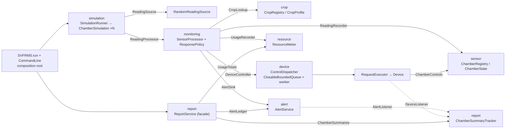
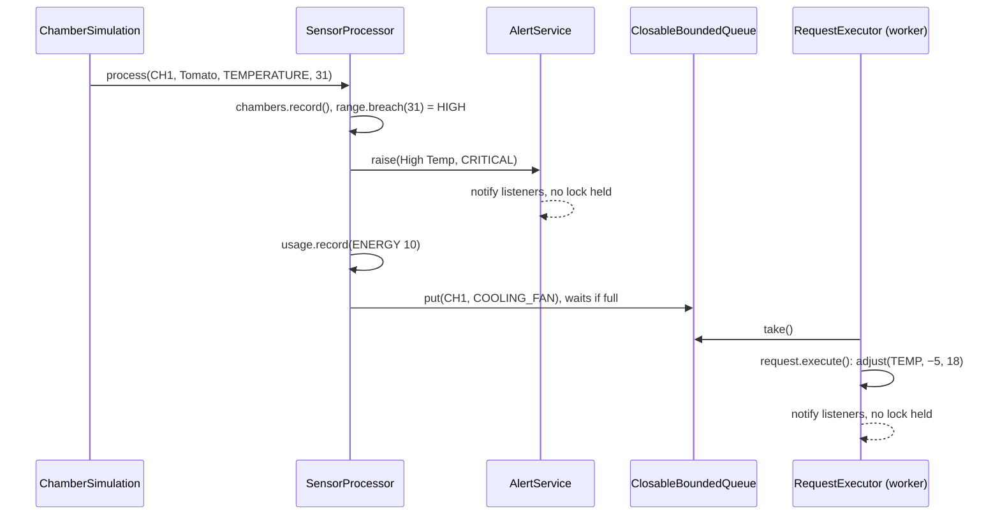
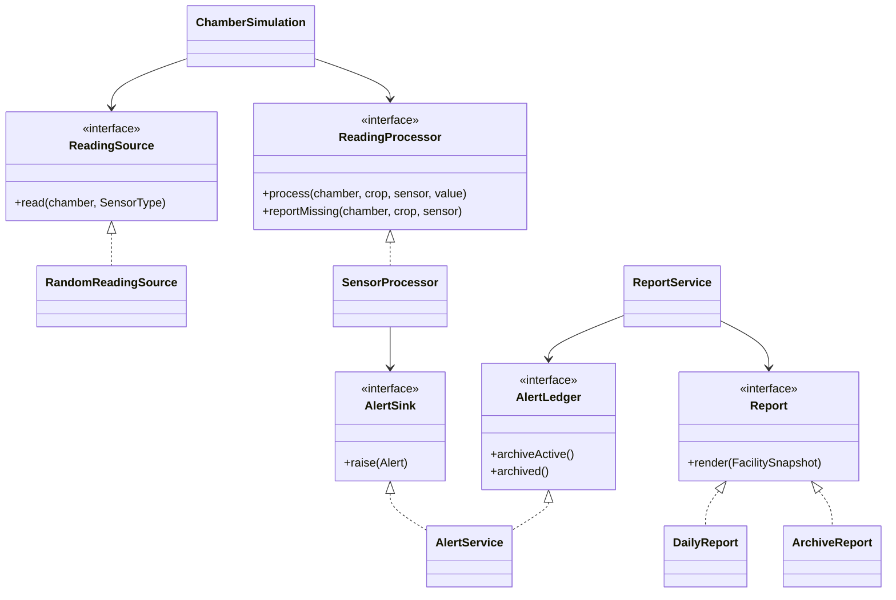
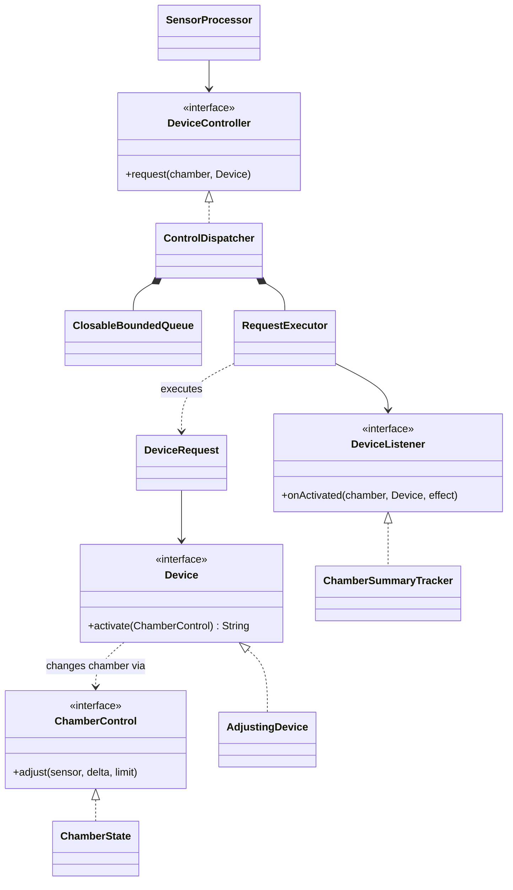

# SVFRMS Refactoring — Technical Report

## 1. Legacy System Analysis

SVFRMS monitors the growing chambers of a vertical-farming facility. Each chamber grows one crop. Sensors report temperature, humidity, soil moisture, light and nutrient levels. A reading outside the crop's range raises an alert, records water or energy use and triggers a corrective device (cooling fan, water pump, humidifier, …). At the end of a run the system archives alerts, prints a daily report and saves an archive report to `archive/daily_report.txt`.

The legacy code is one 393-line class, `SVFRMS`, whose main components are:

| Component | Legacy location |
|---|---|
| Global mutable state: alert/log/report lists, counters, chamber maps, four locks | `public static` fields, lines 7–31 |
| Chamber state and per-chamber summary | nested classes `ChamberState`, `ChamberSummary`, lines 33–60 |
| Event handling: logging, alert creation, tracking | `handleEvent(String type, …)` string switch, lines 62–88 |
| Device control and its queue (producer–consumer) | `activateControl` if/else chain (90–129); `addControlRequest` + `ControlThread`, `wait/notifyAll` on an `ArrayList` (131–139, 251–273) |
| Crop threshold rules | `processSensor`: 65 lines of nested `if (crop.equals(...))`, lines 141–205 |
| Reports | `generateDailyReport`, `archiveAlerts`, `saveArchiveReport`, lines 207–241, 309–347 |
| Simulation and start-up | `ChamberThread extends Thread` (275–295), `main` (349–392) |

## 2. Code Analysis and Limitations

### 2.1 Design issues and code smells

| # | Issue (code smell) | Evidence | Principle |
|---|---|---|---|
| D1 | **God class** (large class, divergent change): sensing, crop rules, devices, alerts, reports, file I/O, threads and simulation in one class. | whole file | SRP |
| D2 | **Crop rules hard-coded** (long method, duplicated code, shotgun surgery): adding Kale means a new `if` block in up to three sensor branches of `processSensor`; thresholds, costs and devices are **magic numbers** repeated per crop. | lines 145–188 | OCP |
| D3 | **Stringly-typed dispatch** (primitive obsession): `handleEvent("TRACK_ALERT", …)`, `activateControl(…, "Cooling Fan")`; queue items are `chamber + "\|" + control`, split again later. Typos fail silently; a `\|` in a chamber name breaks parsing. | lines 62–129, 136, 269 | OCP, type safety |
| D4 | **Inheritance where composition belongs.** `ChamberThread` and `ControlThread` extend `Thread` although they are tasks, not specialised threads. `main` does substitute them (`Thread t1 = new ChamberThread(…)`, then `start()`/`join()`, lines 350–354), and that substitution is LSP-safe: only `run()`, the hook `Thread` provides for exactly this, is overridden, and `Thread` never promises to stop on `interrupt()` (interruption is cooperative). So no LSP violation was found. The cost is design: one thread per task is fixed by the type, and `ControlThread` swallowing `InterruptedException` (line 258) is a reliability defect (D8, C7). | lines 251–275, 350–354 | LSP (checked: none), composition over inheritance |
| D5 | **Fat, implicit interface**: `handleEvent` is one entry point for six unrelated operations; every caller depends on all of them. | line 62 | ISP |
| D6 | **Dependence on globals and concretions**: every collaborator is a `public static` field; nothing can be replaced or tested alone. | lines 10–31 | DIP |
| D7 | **Dead code**: `waterPumpLock`, `nutrientLock`, `irrigationCycle`, `feedingCycle`, `showAlerts`, `showLogs`, the `ALERT_LOG` branch, commented-out `sleep` calls — none is ever called. | lines 28–29, 66–68, 224, 243–249, 297–307, 385 | Clean code |
| D8 | **Swallowed exceptions**: `catch(Exception e){}` hides interrupts; `saveArchiveReport` prints an I/O error and the run still "succeeds". | lines 134, 258, 344 | Reliability |

### 2.2 Behavioural quirks (kept, see §3.3)

- Soil checks exist only for Tomato (and only its minimum); humidity checks only for Tomato and Strawberry. The spec's soil range for Strawberry and humidity/soil ranges for Lettuce were never coded.
- Light (< 500 lux) and nutrient (< 40 %) limits are facility-wide, and their alert text omits the crop. Low temperature alerts but starts no device (no Heating Unit).
- A queued device request can run after a newer reading of the same sensor (a fan queued at 35 °C runs after a 20 °C reading). This is a logical ordering issue, not a data race.
- Never implemented: severity levels, Sensor Failure alerts, Heating Unit, Ventilation System, Shade Controller and the weekly, water, energy and nutrient reports. §5 shows where each plugs in; severity and Sensor Failure were added (§3.3).

### 2.3 Concurrency issues

Four `ChamberThread`s and one `ControlThread` share all static state with no consistent locking.

| # | Type | Where | Failure |
|---|---|---|---|
| C1 | Race condition | `alerts` and `sensorLogs` are plain `ArrayList`s written by the 4 chamber threads (lines 64, 73) | Lost alerts, corrupted array, `ArrayIndexOutOfBoundsException` |
| C2 | Check-then-act race | `getChamberState`/`getChamberSummary`: `containsKey` → `put` on a `HashMap` | Two states for one chamber; `HashMap` corruption → `NullPointerException` |
| C3 | Lost update | `totalWaterUsage += …`, `totalEnergyUsage`, `totalAlerts++`, `totalAlertsGenerated++` | Non-atomic read-modify-write → wrong totals |
| C4 | Data race / visibility | `ChamberState` fields written by chamber threads and read-modify-written by the control thread with no lock | Device effect lost or computed from a stale value |
| C5 | Lost summary (via C2) | `getChamberSummary` is called by a chamber thread (alerts) and the control thread (actions) for the same chamber; its check-then-act can create two `ChamberSummary` objects, and one is lost | Summary alert/action counts don't add up |
| C6 | Order race | `main` starts `archiveAlerts` and `generateDailyReport` threads at once | "Active Alerts" is 0 or N at random, and the archive's activity lines ("Daily Report", "Archived N alerts") come in either order (the commented `sleep(20)` shows it was noticed) |
| C7 | Liveness (deadlock-like hang) | Producers `wait()` on a full queue with no timeout; if `ControlThread` dies (any `RuntimeException`, e.g. the C2 NPE) nobody consumes | All chamber threads block forever; `main` hangs in `join()` |
| C8 | Latent deadlock | Nested `synchronized(alertLock){ synchronized(reportLock){…} }` in two methods (lines 208–209, 223–230); the locks are `public static`, **non-final** | No deadlock today, because both methods take the locks in the same order (alert, then report), and `wait()` releases the queue monitor. But any new code that takes them in the other order, or reassigns a lock, deadlocks or breaks mutual exclusion |
| C9 | Unsafe iteration (latent) | `showAlerts`/`showLogs` iterate lists other threads modify; both are dead code today (D7) | `ConcurrentModificationException` as soon as either is called during a run |

**Measured** (150 runs per version, Linux, JDK 21; each run checked against its own synchronized console output). The rates depend on the platform: on Windows 11 with JDK 25 the legacy version crashed with a `NullPointerException` in 42 of 60 runs and the refactored version in none; `tools/compare_legacy.sh` reproduces the count and the output comparison of §3.3.

| Symptom | Legacy | Refactored |
|---|---|---|
| Crash: `NullPointerException` in a chamber thread (C2) | 3 | 0 |
| Archive lists fewer alerts than were raised (C1) | 5 | 0 |
| Wrong water/energy total (C3) / wrong "Generated Alerts" (C3) | 5 / 2 | 0 / 0 |
| Chamber summary counts wrong (C5) | 1 | 0 |
| "Active Alerts" in the daily report (C6) | 0 in 130 runs, N in 20 | 0 in all 150 |

No hang (C7) occurred in these runs because the NPEs hit chamber threads. `legacy/LegacyHangDemo.java` forces the same NPE in the control thread, by swapping the public, non-final `chamberStates` field (D6) without editing the legacy code. It hangs in 5 of 5 runs: all four chamber threads wait forever in `addControlRequest` (line 134) and `main` never returns. Refactored, a dead worker wakes and rejects blocked producers (`ControlDispatcherLifecycleTest`), and `SVFRMS.run` turns the failed run into exit status 1 with no report (`SimulationRunnerTest`).

## 3. Proposed Design

### 3.1 Key decisions, by SOLID principle

| Principle | Change (fixes) |
|---|---|
| **SRP** (D1) | Nine packages plus the composition root, one reason to change each (§4). The old dispatcher was split again: `ControlDispatcher` owns only the worker's lifecycle, `ClosableBoundedQueue` only blocking, `RequestExecutor` only running a request, `Listeners` only fault-isolated notification. |
| **OCP** (D2, D3) | Crops are data: a `CropProfile` holds a `Range` per sensor and the cost per breach. `SensorProcessor` has one generic rule (*breach → alert → cost → device*); no crop name appears in logic. Crops can even be added or removed at run time with no rebuild (`--add-crop`, `--remove-crop`). Every "for each sensor" loop iterates `SensorType`. |
| **LSP** (D4) | Composition replaces `Thread` inheritance: chamber work is a `Callable` run by an `ExecutorService`, and the dispatcher owns its worker. The new design has real substitution points, and the tests use them: scripted `ReadingSource`s (`SensorExtensibilityTest`), throwing and blocking `Device`s (`ControlDispatcherLifecycleTest`), lambda `DeviceController`s and failing listeners (`ListenerIsolationTest`). The code under test cannot tell a stand-in from the production class. |
| **ISP** (D5) | Small, client-specific roles (`AlertListener`, `DeviceListener`, `DeviceController`, `Device`, `ChamberControl`, `Report`, `ReadingSource`): each client depends only on what it uses. Services expose a separate interface per client: `AlertService` is an `AlertSink` to monitoring and an `AlertLedger` to reporting; `ResourceMeter` is a `UsageRecorder` and `UsageTotals`; `ChamberRegistry` is only a `ReadingRecorder` to monitoring and only `ChamberControls` to devices, so neither can do the other's job. |
| **DIP** (D6) | Constructor injection: the composition root (`SVFRMS.run`, `CommandLine`) chooses and creates every replaceable collaborator, including the `Report`s handed to `ReportService`. Services build only their own private parts (the dispatcher's queue, worker thread and executor; a listener list). `ArchitectureTest` checks by reflection that every constructor of `SensorProcessor`, `ReportService`, `ChamberSimulation`, `ControlDispatcher`, `RequestExecutor` and `AlertService` takes only interfaces or immutable values. |

Dead code was removed (D7), including the sensor log that legacy wrote but never read; no production method exists only for tests. I/O errors now set the exit status, and interrupts are restored (D8).

### 3.2 Concurrency fixes

| Issue | Fix |
|---|---|
| C1, C9 | Each shared list has one owner that guards it (`AlertService` synchronized). Readers get immutable copies, so iteration never races. The report activity log is written only by the main thread; its `synchronizedList` is defensive. |
| C2 | `ConcurrentHashMap.computeIfAbsent` (atomic get-or-create) in `ChamberRegistry` and `ChamberSummaryTracker`. |
| C3, C5 | `AtomicInteger` counters in `ResourceMeter`; alert counters change under the same lock as the alert list; one summary per chamber (`computeIfAbsent`, C2), updated under its own lock. |
| C4 | `ChamberState` is an `EnumMap` behind `synchronized` methods; every device change is one atomic `adjust` (read, add, clamp, write), so no effect is lost. Device code runs outside the lock (`deviceCodeRunsWithNoChamberLockHeld`). The ordering quirk of §2.2 is functionality, not a race, so it is kept. |
| C6 | Archive, then daily report, sequentially, after all producers and the consumer have finished. |
| C7 | `ClosableBoundedQueue` (one `ReentrantLock`, two `Condition`s) replaces `wait/notify`. If the worker dies, `abort` wakes every blocked producer at once with an error: no hang and no polling. Shutdown takes effect when the queue closes (admission is decided under the queue's lock): a request admitted before then runs, one after is rejected, also when `close()` comes before `start()`. `close()` lets the worker drain the queue, waits at most 30 s and reports any request not executed; a second concurrent `close()` waits for the same drain. A concurrent second `close()` waits for the same drain and reports the same failure. If the timeout expires, queued requests are dropped (and counted) before the worker is interrupted, so nothing runs after `close()` gives up. Devices that throw are logged and counted; the worker carries on; a request killed by an `Error` is counted as not executed. Chamber tasks are `Callable`s and `SimulationRunner` checks every `Future`, so a failed chamber fails the run (exit 1); an interrupted runner cancels its chambers instead of waiting for them. |
| C8 | **No nested locks anywhere**, by construction: each component guards its own state with one lock, and listeners and device code run outside every lock. Reports read an immutable `FacilitySnapshot`, built after every thread has finished. |

Tests: `countersSurviveConcurrentUpdates` (8 threads × 5 000 updates, exact totals), `closeDuringHeavyProductionLosesNothing` (close races 8 producers; every request runs or is rejected), `deviceCodeRunsWithNoChamberLockHeld`, worker death with a full queue, a hanging device, close before start, two concurrent closes, an interrupted runner, a sub-millisecond shutdown timeout, and a failed run ending in exit 1 with no report.

### 3.3 Behaviour preservation

Thresholds, alert texts, resource costs, device effects, console formats and the archive layout are identical: the sets of distinct output lines of 25 legacy and 25 refactored runs (numbers masked) were diffed and match (`tools/compare_legacy.sh`); `GoldenOutputTest` pins every console line shape and the archive layout in the build. The quirks in §2.2 are kept because the brief forbids changing functionality; each is now a one-line data change (e.g. `.soilMoisture(50, 65)` on Strawberry). The one bound legacy ignores, Tomato soil above 60 %, is declared on the crop (`.ignoreBreach(SOIL_MOISTURE, HIGH)`) rather than hidden in the policy, which must cover every sensor and direction. Deliberate changes appear only when triggered:

- C6 is deterministic: "Active Alerts" is always 0, the legacy majority outcome.
- **Sensor Failure** (spec §3.4): a reading a sensor cannot produce (NaN, infinite, outside its physical range, e.g. 150 % humidity) or no reading at all raises a CRITICAL `CHn Sensor Failure: …` alert and is never stored or acted on. Ranges, costs and resource amounts are validated. The random feed never fails, so this path is reached through the `ReadingSource` seam (tests, real hardware).
- **Severity** (spec §3.4): every alert carries INFO, WARNING or CRITICAL (temperature breaches are CRITICAL, as in the spec's example). `--alert-format=severity` prints `CRITICAL: CH3 Lettuce High Temp`; the default console format is unchanged.
- `CHn=Crop` arguments replace the default four chambers (`java -jar run.jar CH1=Tomato CH5=Kale` runs two). New crops get alerts on both bounds of every range they define (e.g. `CH5 Kale High Soil Moisture`).
- If the archive cannot be saved, the legacy message is printed and the cause goes to stderr.
- Exit status: 0 success; 1 run failed (no report written); 2 archive not saved; 3 invalid arguments.

## 4. Final Architecture

**Component diagram**

**Sequence: one out-of-range reading**

**Class diagrams: monitoring, alerts and reporting (left); device control (right)**

| Package | Main classes | Responsibility |
|---|---|---|
| `crop` | `CropProfile` (+Builder), `Range`, `CropRegistry`, `CropCatalog`, `CropSpecParser` | What each crop needs |
| `sensor` | `SensorType`, `Breach`, `ChamberState`, `ChamberRegistry` (`ReadingRecorder`, `ChamberControls`) | Readings and chamber conditions |
| `monitoring` | `SensorProcessor`, `ResponsePolicy`, `Response` | Reading → alert / cost / device rule |
| `device` | `ControlDispatcher`, `ClosableBoundedQueue`, `RequestExecutor`, `DeviceRequest`, `Devices` | Executing corrective actions |
| `alert`, `resource` | `AlertService`, `Severity`, printers; `ResourceMeter`, `Usage` | Alert lifecycle; water and energy |
| `report` | `ReportService`, `DailyReport`, `ArchiveReport`, `FacilitySnapshot`, `ChamberSummaryTracker` | Reporting |
| `simulation`, `support` | `ChamberSimulation`, `SimulationRunner`, `RandomReadingSource`; `Listeners` | Sensor feed; isolated notification |

## 5. Extensibility and Maintainability

| Change | What to touch |
|---|---|
| Add / remove a crop | One `CropCatalog` entry, or no code at all: `--add-crop="Okra:temperature=24..30,soil=50..70"`, `--remove-crop=Tomato`. |
| Add a device (e.g. Heating Unit) | One `Devices` constant, referenced from the `Low Temp` entry of `ResponsePolicy.standard()`; no logic changes. |
| New sensor type | One `SensorType` constant, its two `ResponsePolicy` entries and its simulated range; start-up fails fast if either is missing. Parsing, simulation and state follow automatically. |
| New report (weekly, water, energy, nutrient) | A new `Report` rendering `FacilitySnapshot`, plus one `ReportService` method that prints or saves it and one line wiring it in `SVFRMS.run`. |
| New alert channel or severity routing | A new `AlertListener` registered in `SVFRMS.run`; a faulty one cannot disturb the others. |
| Real sensors | A new `ReadingSource`; an unresponsive sensor already raises a Sensor Failure alert. |

Every change is additive and local. Constructor injection lets each component be tested alone: 69 tests in 15 classes cover behaviour parity, every crop bound, validation, concurrency, shutdown, run-time crops and exit codes.

## 6. Design Patterns

| Pattern | Where | Problem solved | Why this rather than the alternative |
|---|---|---|---|
| **Builder** | `CropProfile.Builder` | A crop has up to five optional ranges, costs and exceptions, plus facility defaults. | A constructor with a dozen optional arguments is unreadable and error-prone; setters would make profiles mutable while chamber threads read them. The builder validates each range and yields an immutable profile. |
| **Strategy** | `Report` (`DailyReport`, `ArchiveReport`, injected into `ReportService`); `ReadingSource` (`RandomReadingSource`, test sources, future hardware) | Interchangeable algorithms chosen by the composition root. | The legacy approach, `if/else` on a type string, edits the caller for every new variant (D3). |
| **Observer** | `AlertService` → `AlertListener`s; `RequestExecutor` → `DeviceListener`s | Producers must not know who consumes alerts (console, summary, future email). | Direct calls (`handleEvent`) couple alerting to every consumer; fault isolation in `Listeners` keeps one bad listener from stopping the rest. |
| **Command** | `DeviceRequest.execute` (runs its `Device` on its chamber); `RequestExecutor` is the invoker | Deciding to act (chamber thread) is separated from acting (control thread); the request carries everything needed to run later, in order. | Legacy encoded commands as `"chamber\|control"` strings parsed later (D3). |
| **Producer–Consumer** with guarded suspension | `ControlDispatcher` + `ClosableBoundedQueue` | Back-pressure, one writer for device effects, clean and abnormal shutdown. | `ArrayBlockingQueue` + poison pill (our first version) cannot wake producers when the consumer dies. A bounded `ThreadPoolExecutor` rejects new work when full instead of blocking the producer, so it loses legacy back-pressure. |
| **Facade** | `ReportService` | End-of-run reporting coordinates alerts, usage, summaries, two reports and file I/O. | Callers make three calls instead of reaching into five components, as legacy `main` did. |
| **Special Case** | `SensorProcessor`: an unknown crop gets a default `CropProfile` (facility light and nutrient limits only); a `Response` with no device is `Optional.empty()` | Unknown crops still get the facility-wide checks, as in legacy; alert-only breaches need no device. | `null` checks at every use of the profile or device. |

Supporting idioms: **Static factory methods** (`CropCatalog.defaultRegistry()`, `ResponsePolicy.standard()`, `RandomReadingSource.legacy()`) name the legacy configurations; **Registry** (`CropRegistry`, `ChamberRegistry`, thread-safe lookup); **Immutable Value Objects** (`FacilitySnapshot`, `CropProfile`, records), so reports never hold a lock; **Dependency Injection** with a single composition root (`SVFRMS.run`).

## 7. Build and Run

`mvn clean package` builds `target/run.jar` and runs the 69 tests. `java -jar run.jar` runs the legacy four chambers; `java -jar run.jar --help` lists the options.
